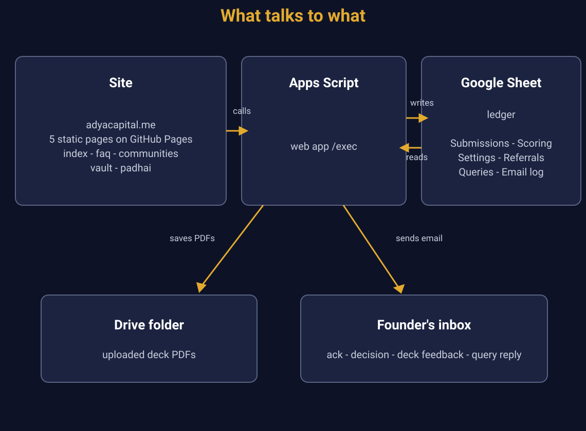

# Adya Capital

Invitation-only venture network for founders. This repository is the public website, served with GitHub Pages.

Live: https://adyacapital.me/



## What it is

A static site with an invite gate. Visitors enter an invite code (ADYA-xxxxx) or apply directly through the slower open lane. Every applicant gets an instant acknowledgement email, a ticket, and their own 5-use referral code. Decks are scored on a 100-point rubric, the Investment Committee decides in the backend Sheet, and the decision reaches the founder by email. Founders can check their status and full score breakdown anytime with email + ticket.

## Pages

| Page | Access | What it does |
| --- | --- | --- |
| `index.html` | Public | Landing, invite gate, application form (deck link or PDF upload + written pitch), application status check |
| `faq.html` | Public | 22 questions in 6 journey groups, plus a raise-a-query form that lands in the backend |
| `communities.html` | Public | Hand-picked founder communities (Slack, WhatsApp) and founders who openly help, grouped by stage and need |
| `vault.html` | Members | Fund Vault: 50+ venture funds, accelerators and angel networks with filters for stage, geography, sector and type |
| `padhai.html` | Members | Founder Academy: a chronological 7-lesson path with insider red pills, valuation calculators, and verified readings |

Members-only pages check a locally stored verified code and carry `noindex`. This is a courtesy gate, not a security boundary.

## Structure

| File | Purpose |
| --- | --- |
| `index.html` | Landing page, invite gate, application form, status check, SEO and Open Graph tags |
| `faq.html`, `faq.js` | FAQ page and its question data |
| `communities.html` | Public communities directory |
| `vault.html`, `vault.js`, `funds.js` | Members-only vault page (noindex) and fund data |
| `padhai.html`, `padhai.js` | Members-only learning page (noindex) |
| `theme.css` | All styling, including the mobile breakpoints |
| `app.js` | Gate, application flow, status check, member view |
| `club.js` | Member club content |
| `music.js`, `raga-pahad-wind.b64` | Ambient raga ("Wind from the Mountain - Raga Pahad" by Saseendran, Pixabay Content License). The track ships as base64, decodes into a Web Audio buffer, loops seamlessly. White pill toggle, bottom right; preference persists in localStorage |
| `config.js` | Backend endpoint |
| `mark-t.png`, `favicon.png`, `apple-touch-icon.png`, `og.png`, `skyline.jpg` | Logo, icons, link-preview image, hero image |
| `robots.txt`, `sitemap.xml` | Crawler rules and sitemap |
| `.nojekyll` | Serve files as-is on GitHub Pages |
| `docs/` | Backend notes, flow diagrams, changelog |

## Backend

Applications, invite codes, nominations, tickets, scoring and email are handled by a Google Apps Script web app bound to a Google Sheet. The endpoint URL is set in `config.js`.

- Reads and writes: applications, referral codes and nominations, raise-a-query messages, deck scores, and an email log (so nobody is emailed twice).
- Sends: instant application acknowledgements, approve and reject decision emails (a time-driven trigger), detailed deck feedback, and the FAQ query auto-reply.
- Invite rules (founder codes, nominations per member, retired codes) live in the Sheet's Settings tab, not in this repo.
- Uploaded deck PDFs land in a Drive folder.

More detail in [docs/BACKEND.md](docs/BACKEND.md). Release history in [CHANGELOG.md](CHANGELOG.md).

## TEST environment

A separate TEST ledger, TEST backend deployment and TEST upload folder exist for previewing changes before they go live. Nothing applicant-facing ships without verification on the live site.

## Run locally

No build step. From the repo root:

```
python3 -m http.server 8000
```

Open http://localhost:8000.

## Deploy

GitHub Pages serves the `main` branch from the repo root. Pushing to `main` publishes the site within a minute or two. The custom domain `adyacapital.me` (see `CNAME`) points at it, so the site and `robots.txt` sit at the domain root.

## SEO

Title and description, canonical URL, Open Graph and Twitter tags, JSON-LD Organization data, `sitemap.xml`, and `robots.txt` that allows the public pages and blocks the members-only pages.

## Conventions

Small commits with a clear message (`feat:`, `fix:`, `content:`, `seo:`, `docs:`). Do not commit secrets or member data.
